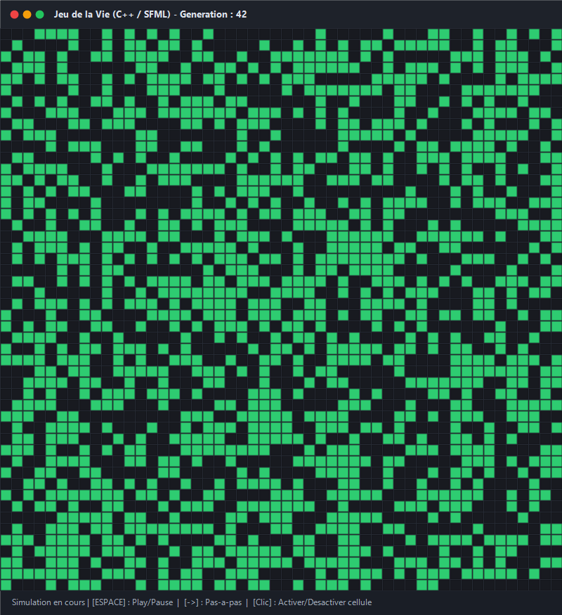

# 🧬 POO-main – Jeu de la Vie (C++ & SFML)



## 📌 Description
Ce projet est une implémentation en **C++ orienté objet** du célèbre **Jeu de la Vie de Conway**.  
L’objectif est de simuler l’évolution d’une grille composée de cellules **vivantes** ou **mortes**, avec possibilité d’interactions complètes via une interface graphique SFML ou en mode console.

Le projet illustre les concepts clés de la **programmation orientée objet (POO)** :
- **Héritage et polymorphisme** (`Cellule`, `CelluleVivante`, `CelluleMorte`, clonage polymorphique).
- **Encapsulation et robustesse mémoire** (Règle des 5 pour `Grille`, absence de fuites).
- **Modularité et séparation des responsabilités** (`Grille`, `Simulation`, `InterfaceGraphique`, `FichierTexte`).
- **Persistance** (Lecture et écriture de fichiers texte).

---

## 🚀 Fonctionnalités principales
- 🔲 Représentation matricielle d’une grille de cellules vivantes et mortes (support des grilles toriques et non-toriques).
- ▶️ Simulation de l’évolution des générations selon les règles standard de Conway.
- 📂 Lecture et sauvegarde de grilles depuis/vers des fichiers texte (`GrilleInitiale.txt`, `GrilleFinale.txt`).
- 🖥️ **Interface graphique interactive (SFML)** :
  - `[ESPACE]` : Mettre en pause ou relancer la simulation automatique.
  - `[FLÈCHE DROITE]` : Avancer pas-à-pas (génération par génération).
  - `[FLÈCHE HAUT / BAS]` : Régler la vitesse de simulation.
  - `[CLIC GAUCHE]` : Activer ou désactiver interactivement une cellule avec la souris.
- 💻 **Mode Console** :
  - Défilement pas-à-pas avec `[Entrée]`.
  - Mode automatique avec la touche `a`.
  - Sortie propre avec la touche `q`.
- ⚙️ **Makefile universel** pour compiler facilement le projet sous Linux et Windows (MSYS2/MinGW).

---

## 🛠️ Technologies utilisées
- **C++17 (POO)**
- **SFML (Simple and Fast Multimedia Library)** pour le rendu graphique et la gestion des événements
- **Makefile** pour la chaîne de compilation

---

## 📂 Structure du projet
```bash
Programmation-orient-e-objet/
│── Makefile                  # Script de compilation automatisé
│── .gitignore                # Fichiers et binaires ignorés par Git
│
├── include/                  # Fichiers d'en-tête (.h)
│   ├── Cellule.h             # Classe de base abstraite polymorphique
│   ├── CelluleVivante.h      # Sous-classe concrète pour cellule vivante
│   ├── CelluleMorte.h        # Sous-classe concrète pour cellule morte
│   ├── Grille.h              # Gestionnaire de grille (Règle des 5, transitions)
│   ├── Simulation.h          # Orchestrateur de la logique de simulation
│   ├── FichierTexte.h        # Persistance et gestion des flux de fichiers
│   └── InterfaceGraphique.h  # Interface graphique interactive SFML
│
├── src/                      # Fichiers sources (.cpp)
│   ├── Cellule.cpp
│   ├── CelluleVivante.cpp
│   ├── CelluleMorte.cpp
│   ├── Grille.cpp
│   ├── Simulation.cpp
│   ├── FichierTexte.cpp
│   ├── InterfaceGraphique.cpp
│   └── main.cpp              # Point d’entrée du programme
│
├── data/                     # Jeux de données (fichiers texte)
│   ├── GrilleInitiale.txt    # Exemple d'état initial de la grille
│   └── GrilleFinale.txt      # Sauvegarde de l'état final de la grille
│
└── assets/                   # Ressources multimédias
    └── game_preview.png      # Capture d'écran de l'interface
```

---

## ⚡ Compilation & Exécution

### Prérequis
- Un compilateur C++ supportant le standard C++17 (`g++` ou `clang++`).
- La bibliothèque **SFML** (`libsfml-dev` sous Debian/Ubuntu ou via MSYS2 sous Windows).

### Compilation
```bash
make
```

### Exécution
```bash
./main
```

### Nettoyage
```bash
make clean
```

---

## 👥 Auteurs & Contributeurs
- **Nicolas KANIAN**
- **Gauthier WEIBEL**
